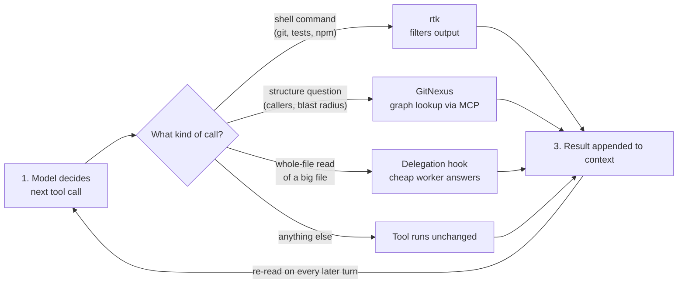
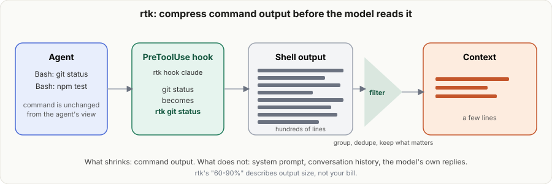
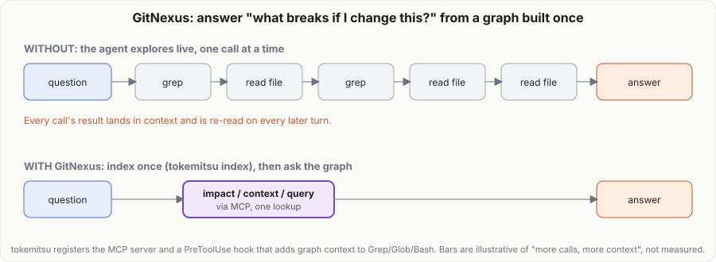
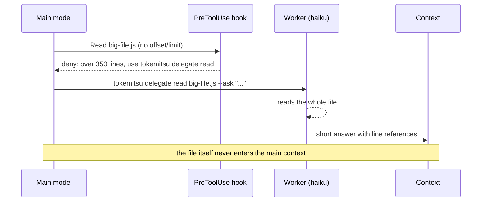

# tokemitsu

Cut your **Claude Code** token usage and see what was actually recorded.

One package that sets up three token-saving lanes, runs entirely on your machine (no API keys), and shows a
plain report of **recorded usage** in the terminal and in a small local dashboard. No prices or savings are assumed.

| Lane | What it does | Who maintains it |
| --- | --- | --- |
| **rtk** | Compresses noisy shell output (git, test runners, ls...) before it reaches the model | [rtk-ai/rtk](https://github.com/rtk-ai/rtk) |
| **GitNexus** | Local code knowledge graph over MCP, so the agent asks instead of grep-and-read | [GitNexus](https://github.com/abhigyanpatwari/GitNexus) |
| **Delegation** | Big file reads are answered by a cheap model (Haiku) through your own `claude` CLI; boilerplate can be generated the same way | this package (pattern from Spotify Engineering, see [NOTICE.md](NOTICE.md)) |

rtk and GitNexus are **installed from their original sources and run unmodified**. This package never copies their
code, so their maintainers keep owning updates; `tokemitsu update` pulls them.

> **License heads-up.** GitNexus is PolyForm Noncommercial. If you use Claude Code for company work you need a
> commercial license from its authors, or skip it with `--skip-gitnexus`. Details in [NOTICE.md](NOTICE.md).

## Requirements

- Node 18.3+
- [Claude Code](https://docs.claude.com/en/docs/claude-code) (`claude` on PATH, logged in)
- For GitNexus: whatever Node range it declares (currently needs a recent Node 22/24; `verify` tells you)

## Quick start

```bash
npm install -g tokemitsu

tokemitsu setup            # installs + wires rtk and GitNexus into Claude Code, then verifies
tokemitsu index            # inside a repo: build its GitNexus graph
tokemitsu delegate enable  # opt in to the cheap-model pattern for this project
# ...use Claude Code as normal, then:
tokemitsu report           # terminal summary
tokemitsu dashboard        # local dashboard at http://127.0.0.1:4777
```

Restart Claude Code after `setup` / `delegate enable` so it loads the new hooks and MCP server.

## Commands

| Command | Purpose |
| --- | --- |
| `tokemitsu setup [--yes] [--accept-gitnexus-license] [--skip-rtk] [--skip-gitnexus] [--index] [--with-delegate]` | Install and wire rtk + GitNexus; each mutating step asks first |
| `tokemitsu verify [--worker] [--latest] [--json]` | Health checks with a fix hint per failure. `--worker` does a real cheap-model round-trip |
| `tokemitsu update [rtk\|gitnexus\|all] [--check] [--dry-run]` | Pull upstream releases via each tool's own update path |
| `tokemitsu rtk <args>` | Runs the real `rtk` (e.g. `tokemitsu rtk gain`) |
| `tokemitsu gitnexus <args>` / `tokemitsu gn <args>` | Runs the real GitNexus (`query`, `context`, `impact`, `analyze`, ...) |
| `tokemitsu index` | Shortcut for `gitnexus analyze` in the current repo |
| `tokemitsu delegate enable\|disable [--global]` | Install or remove the Claude Code hooks + skill |
| `tokemitsu delegate read <file> --ask "<question>"` | Cheap model answers about a big file |
| `tokemitsu delegate write --like <ref>... --spec "<what>" [--out <file>]` | Cheap model generates boilerplate in the style of your reference files |
| `tokemitsu graph-bench <symbol>` | Measure GitNexus vs grep-and-read on your own repo |
| `tokemitsu report [--since 30d\|all] [--here\|--project <path>] [--json]` | Recorded usage |
| `tokemitsu dashboard [--port 4777] [--open]` | Local web dashboard |
| `tokemitsu uninstall [--global] [--purge]` | Remove our hooks/skill (and optionally our data) |

Passthrough commands hand every argument to the original tool untouched, so anything rtk or GitNexus supports
works, including features added after this package was released.

## Where each tool sits in the agent loop

Every agentic coding session is the same loop: the model decides, calls a tool, the tool's result is appended to
context, and the whole (growing) context is read again on the next turn. All three lanes attach to the same seam,
the moment a tool result is about to re-enter context, and each one catches a different kind of call.
(The framing of "three layers on one loop" follows
[AI Tokenomics - Your Agent on a Budget](https://medium.com/@wajahat.rahman/ai-token-economics-your-agent-on-a-budget-b6f37b74ee48);
the diagrams here are original and show what tokemitsu actually wires up.)

<p align="center"></p>



### Integration points

| Lane | Loop stage | How tokemitsu wires it | What gets smaller |
| --- | --- | --- | --- |
| rtk | Bash tool result | `PreToolUse` hook on `Bash` (`rtk hook claude`) rewrites `git status` to `rtk git status` | Command output |
| GitNexus | Exploration calls | MCP server registered in Claude Code, plus a `PreToolUse` hook on `Grep\|Glob\|Bash` that adds graph context and a `PostToolUse` index-freshness check | Number of grep/read calls needed to answer a structure question |
| Delegation | `Read` tool result | `PreToolUse` hooks on `Read` and `Bash` (`tokemitsu hook pre-tool`) deny whole-file reads over the line threshold and point at `tokemitsu delegate read` | The file contents entering the main context |

### rtk: compress output before the model reads it

<p align="center"></p>

### GitNexus: one graph lookup instead of live exploration

<p align="center"></p>

### Delegation: the big file goes to a cheap worker

<p align="center"></p>



### What each lane does and does not reduce

- **rtk** shrinks command output only. System prompt, history and the model's own replies are unchanged, so the
  percentage rtk reports is about output size, not your bill.
- **GitNexus** removes exploratory calls; it does not shrink what the model writes or the code it must still read to edit.
- **Delegation** keeps the file out of the main context, which protects the window the main model reasons in. The
  worker still reads the whole file, so the cost saving is much smaller than the context saving, and every call adds
  seconds of latency. Editing, reasoning and review stay with the main model.
- The animations show the mechanism, not measured amounts. For measured figures use `tokemitsu report` (see
  [Reading the numbers](#reading-the-numbers)) and `tokemitsu graph-bench <symbol>`.

## How the delegation lane works

`delegate enable` adds two PreToolUse hooks to `.claude/settings.local.json` (or `~/.claude/settings.json` with
`--global`) and a skill that teaches Claude when to use the commands.

- A whole-file `Read`, or `cat`/`bat`/`head -n <big>` on a file over **350 lines** (`TOKEMITSU_MIN_LINES`) is
  blocked with a message pointing to `tokemitsu delegate read`. Reads with `offset`/`limit`, and grep pipelines, are never blocked.
- The worker is `claude -p --model haiku` with no tools, no MCP, no session file, in a neutral directory, using
  your existing Claude Code login. The hook fails open (never blocks) if the CLI is missing, the file is binary or
  huge, or you set `TOKEMITSU_BYPASS=1`.
- Don't delegate editing, reasoning or review; the skill says so too.

## Reading the numbers

Everything shown was recorded by something; nothing is priced, extrapolated or compared with an imagined baseline.

| Figure | Basis | Where it comes from |
| --- | --- | --- |
| Claude Code tokens (input, output, cache writes, cache reads) | **recorded** | Claude Code's own session logs, deduplicated per response |
| rtk commands / tokens saved | **reported** | rtk's own counter (`rtk gain`, its bytes/4 estimate). Machine-wide, so it ignores `--project` |
| GitNexus calls and bytes returned | **measured** | GitNexus MCP calls and result sizes found in your Claude Code logs |
| Delegation calls, lines read, worker tokens, worker cost | **measured** | This tool's ledger, using the figures the `claude` CLI reported for each worker call |

Caveats:

- There is **no dollar value for Claude Code usage**. On a subscription you are not billed per token, and any price
  would be an assumption. The only dollar figure is the cost the Claude CLI itself reported for cheap-worker calls.
- Cache reads are usually the biggest token number by far; they are cheap re-reads of already-cached context.
- No savings are claimed for GitNexus or delegation. `tokemitsu graph-bench <symbol>` compares GitNexus with
  grep-and-read for one symbol, and that comparison is a simulation you can inspect.

Config (`~/.tokemitsu/config.json` or `<repo>/.tokemitsu/config.json`):

```json
{ "delegate": { "model": "haiku", "thresholdLines": 350 } }
```

## Privacy and security

Everything is local. The dashboard binds to `127.0.0.1`, rejects foreign Host headers and is read-only. We read
`~/.claude/projects/**/*.jsonl` and our own ledger (`~/.tokemitsu/ledger.jsonl`); nothing is uploaded.
The only network calls are the installers/updaters of rtk and GitNexus and, on `--latest`/`update`, version checks.

## Contributing

`npm test` (Node's built-in runner; tests use fake `claude`, `rtk` and `gitnexus` shims). PRs welcome.

## License

MIT for this package. rtk and GitNexus are separate projects with their own licenses. See [NOTICE.md](NOTICE.md).
